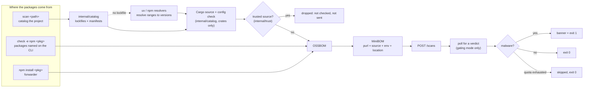
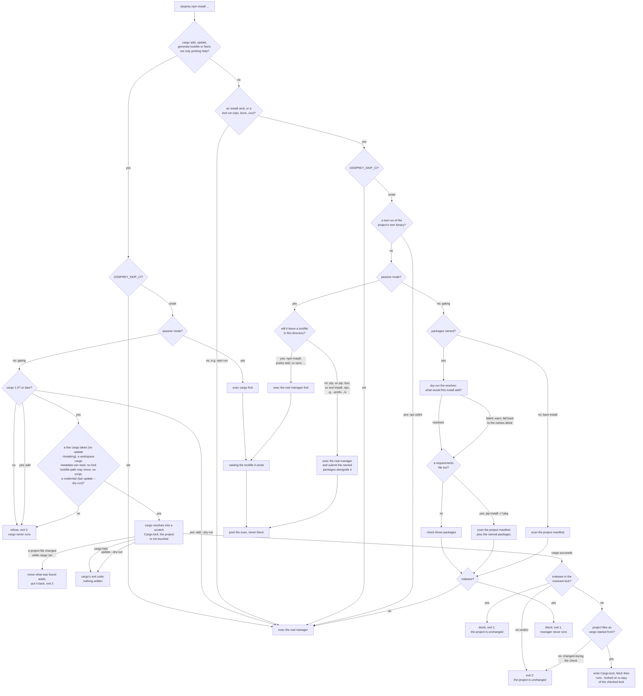
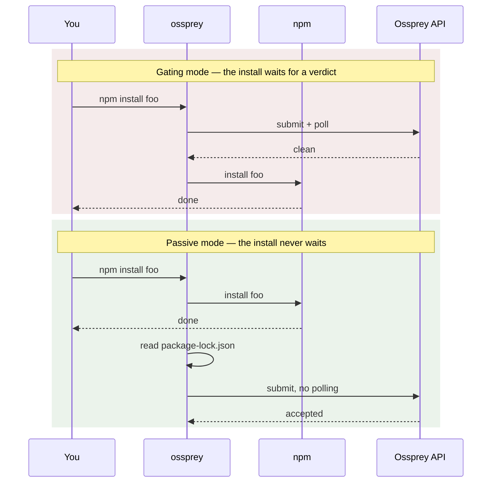

# How it works — diagrams

What happens between your command and a verdict.

## The scan pipeline

Whenever Ossprey checks something — `ossprey scan`, `ossprey check`, or a
forwarded install — it ends up here: a list of packages, compressed to a wire
format, submitted to the Ossprey API. Only a *gating* run polls for the
verdict; passive runs stop at the submission, and commands the forwarder does
not recognise (or that `OSSPREY_SKIP_CI` disables) never enter this pipeline at
all.

Nothing here installs anything. The one exception is the resolver step marked
below, which runs only when a manifest ships without a lockfile.

## A forwarded install

The forwarder decides what to check from the command line alone. Everything it
does not recognise is forwarded untouched — the failure mode is always "the
install still works".

A named gating install does not check only what was typed. `npm install
express` installs 65 packages, so before the check the manager's own kind of
resolver is asked what the install would add, without installing anything —
`npm install --package-lock-only --ignore-scripts` in a throwaway copy of the
project for the npm-side managers, `uv pip compile --no-build` or `pip install
--dry-run --only-binary=:all:` for the Python ones — and the whole tree is
checked at once (`internal/catalog/install_resolve.go`, driven from
`internal/forward/expand.go`). When that dry run cannot be had, the named
packages are checked alone and one warning line says so; the install is never
blocked for want of a prediction.

`cargo update`, `generate-lockfile` and `fetch` are checked by running cargo
against a scratch copy of the lock: `resolver.lockfile-path` sends the lock
there, and only a clean result is written to the project
(`internal/forward/cargo.go`). `cargo fetch` is resolved with `cargo update
--workspace`, which downloads no crate (cargo still checks out git
dependencies to resolve them), and once the lock is written it runs with
`--locked` against a scratch copy of the checked lock. `cargo add` edits
`Cargo.toml` as well as the lock, so it is refused in gating mode until it can
be checked the same way. In passive mode cargo runs first and the lock is
posted. A gating `cargo install` checks each crate at the release crates.io's
index says cargo takes, and is refused with exit 2 when the index cannot say.

The passive branch is the one worth reading twice. It never gates, so it never
sits in front of the install: where a lockfile will land, the install runs
first and Ossprey reads what it wrote, which is both faster and more accurate
than predicting the tree beforehand. Where one will not — pip, `uv pip
install`, `uv tool install`, bun (whose `bun.lock` is not read yet), a tool
run, a global or redirected install — there would be nothing to read, so
the named packages are submitted beside the install instead (`writesLocalLockfile`
in `internal/forward/forward.go` is the one place that decides, for every
command but the cargo ones above).

---

[← Back to the docs index](README.md)
